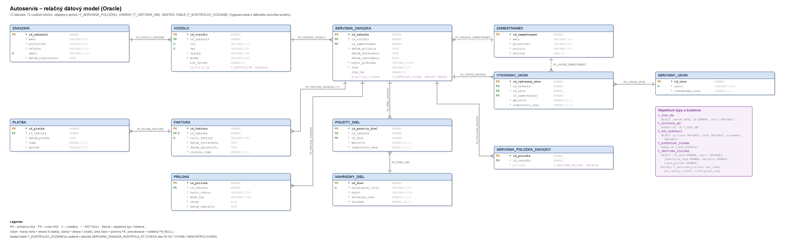

# Autoservis – informačný systém (Oracle + Java Swing)

Semestrálna práca z predmetu *Pokročilé databázové systémy*: databáza autoservisu v Oracle (11 tabuliek),
SQL / PL/SQL logika, objektové typy a kolekcie (VARRAY, NESTED TABLE) v modeli, XML a JSON a desktopová aplikácia,
ktorá to všetko sprístupňuje.

## Opis projektu a dátového modelu

*(pôvodný popis člena 1 – A, doplnený o kolekcie – D)*

Informačný systém na správu autoservisu: evidencia zákazníkov a ich vozidiel, servisné zákazky, vykonané servisné úkony
a použité náhradné diely, faktúry a platby a prílohy (fotografie vozidiel, servisné dokumenty) uložené ako BLOB.



**Dátový model** má 11 základných tabuliek (`ZAKAZNIK`, `VOZIDLO`, `ZAMESTNANEC`, `SERVISNA_ZAKAZKA`, `SERVISNY_UKON`,
`VYKONANY_UKON`, `NAHRADNY_DIEL`, `POUZITY_DIEL`, `FAKTURA`, `PLATBA`, `PRILOHA`) a tabuľku `SERVISNA_POLOZKA_ZAKAZKY`
s objektovým atribútom – spolu 12 tabuliek a 13 cudzích kľúčov. Každá tabuľka má primárny kľúč.

- Model je v **3NF** – údaje zákazníka sa neukladajú do zákazky, ale získavajú sa cez `VOZIDLO`.
- Pri vykonaných úkonoch a použitých dieloch sa uchováva **cena platná v čase opravy**, aby zmena katalógovej ceny
  neovplyvnila historické údaje (`FAKTURA.celkova_suma` je zámerne uložená ako suma vystaveného dokladu).
- **Kolekcie v modeli:** `VOZIDLO.historia_km` – VARRAY(30) záznamov tachometra (dátum, km, zdroj);
  `SERVISNA_ZAKAZKA.kontrolny_zoznam` – NESTED TABLE bodov kontroly pri prijatí (bod, stav, poznámka),
  uložená v `SERVISNA_ZAKAZKA_KONTROLA_NT`. **Objektový atribút:** `SERVISNA_POLOZKA_ZAKAZKY.polozka` typu `T_SERVISNA_POLOZKA`.

**Priebeh zákazky:** zákazník prinesie vozidlo → zákazka `PRIJATA` (s kontrolným zoznamom a stavom tachometra) →
`V_OPRAVE` (úkony, diely) → `DOKONCENA` → faktúra → platba a odovzdanie `ODOVZDANA`; zrušenie `ZRUSENA` z `PRIJATA` / `V_OPRAVE`.

**Fakturácia a tržby:** rozlišujeme fakturovanú sumu (`FAKTURA`) a skutočne prijaté platby (`PLATBA`); jedna faktúra môže
mať viac platieb (čiastočné úhrady). Tržby v reportoch = prijaté platby. Demo dáta: fakturované 337 €, prijaté 269 €,
neuhradený zostatok 68 € (faktúra FA-2026-002).

## Štruktúra aplikácie

Aplikácia má 7 záložiek – od dát cez procesy a reporty po exporty. Každá oblasť je len na jednom mieste.

| Záložka | Čo obsahuje | Témy z cvičení |
|---|---|---|
| **Údaje (CRUD)** | Výber ľubovoľnej z 11 tabuliek; *Pridať*, *Upraviť* (aj dvojklikom), *Zmazať*. Formulár sa skladá z metadát Oracle – cudzie kľúče sú rozbaľovací zoznam s čitateľným popisom, hodnoty CHECK `IN (...)` sú výber, identity a DEFAULT sa doplnia, BLOB príloha sa nahrá zo súboru a *Uloží do súboru*. Chyby obmedzení (FK, CHECK, UNIQUE, NOT NULL) sa zobrazia zrozumiteľne. | CRUD, dátový slovník |
| **Zákazky (PL/SQL)** | Zoznam zákaziek; nová zákazka cez `VYTVOR_SERVISNU_ZAKAZKU`, zmena stavu cez `ZMEN_STAV_ZAKAZKY` (povolené prechody, výnimky), výpis otvorených zákaziek procedúrou `VYPIS_OTVORENE_ZAKAZKY` (DBMS_OUTPUT). | procedúry, kurzory, `%ROWTYPE`, výnimky |
| **Reporty** | Výber reportu: 1 – 9 (povinné výstupy) a doplnkové 13, 13b, 14, 14b nad kolekciami – tabuľka s výsledkom a použitý SQL. | agregácie, dátumy, `RANK`, `ROW_NUMBER`, `LAG`, `SUM() OVER`, `AVG() OVER ROWS BETWEEN`, `TABLE()` nad kolekciou |
| **História vozidla** | Report 10 – výber vozidla, zákazky z SQL kolekcie funkcie `HISTORIA_VOZIDLA` a textový výpis procedúry `VYPIS_HISTORIU_VOZIDLA`. | PL/SQL `RECORD`, kolekcie, `BULK COLLECT` |
| **Objekty a kolekcie** | Podzáložky: *T_SERVISNA_POLOZKA* – položky zákazky ako objektový atribút tabuľky, `get_cena()`, `get_cena_po_zlave()`, triedenie MAP metódou, pridanie konštruktorom (report 11); *T_ZAKAZNIK* – objekty vytvorené v dopyte; *VARRAY – história km vozidla* – zobrazenie s rozdielmi (LAG) a pridanie záznamu procedúrou `PRIDAJ_STAV_KM`; *NESTED TABLE – kontrolný zoznam zákazky* – CRUD nad bodmi cez `INSERT / UPDATE / DELETE … TABLE()`. | objektové typy, konštruktor, MAP, VARRAY, NESTED TABLE |
| **XML** | Výber scenára (servisná zákazka s kontrolným zoznamom – report 12, zákazníci a vozidlá, história vozidla s históriou km, faktúry a platby), parameter (zákazka / vozidlo), generovanie, uloženie do súboru a vyhodnotenie XPath (`EXTRACT`) nad vygenerovaným dokumentom. | `XMLELEMENT`, `XMLATTRIBUTES`, `XMLFOREST`, `XMLAGG`, `EXTRACT` |
| **JSON** | Rovnaké štyri scenáre ako JSON, s parametrom a uložením do súboru. | `JSON_OBJECT`, `JSON_ARRAYAGG`, `JSON_SERIALIZE` |

## Rozdelenie práce v tíme

Rozdelenie vychádza z dokumentu *Rozdelenie práce medzi 3 členov tímu – Checkpoint (5. týždeň)*.
Pri každom členovi je uvedené, za čo zodpovedá podľa plánu, a pri každej položke v zátvorke, **kto ju urobil** –
aj keď išlo o úlohu iného člena.

Skratky autorov: **A** = člen 1 (GitHub: AnatoliuLop), **M** = člen 2 (Matej Paprnák), **D** = člen 3 (Danyil Berezhnyi).

### Člen 1 – Dátový model, databáza a SQL reporty

**Zodpovedá za:** návrh dátového modelu, tabuľky, kľúče a obmedzenia, generovanie testovacích údajov, SQL reporty č. 1, 2, 5, 9,
neskôr množinu min. 100 000 záznamov na analýzu indexov.

| Súbor | Obsah | Urobil |
|---|---|---|
| `Autoservis_ERD.png` | pôvodný ER diagram (11 tabuliek) | (A) |
| `Autoservis_ERD_v2.png` | aktualizovaný ER diagram – 12 tabuliek vrátane `SERVISNA_POLOZKA_ZAKAZKY`, kolekcie a objektové typy; vygenerovaný z dátového slovníka (`tools/ErdGen.java`) | (D) |
| `01_schema.sql` | 11 tabuliek, PK, 11 FK, `NOT NULL` / `UNIQUE` / `CHECK`, identity stĺpce, indexy na FK | (A) |
| `01_schema.sql` – kolekcie v modeli | typy `T_STAV_KM`, `T_HISTORIA_KM` (VARRAY(30)), `T_BOD_KONTROLY`, `T_KONTROLNY_ZOZNAM` (NESTED TABLE); stĺpce `VOZIDLO.historia_km` a `SERVISNA_ZAKAZKA.kontrolny_zoznam` (storage `SERVISNA_ZAKAZKA_KONTROLA_NT` s CHECK na stav) | (D) |
| `02_demo_data.sql` | 45 testovacích záznamov | (A) |
| `02_demo_data.sql` – kolekcie | história tachometra 5 vozidiel (2 – 3 záznamy, posledný = stav km pri zákazke) a kontrolné zoznamy 5 zákaziek (5 – 6 bodov, chyby zodpovedajú popisu problému) | (D) |
| `02a_migracia_kolekcie.sql` | migrácia už existujúcej schémy (vytvorenej starším `01_schema.sql`) – typy, `ALTER TABLE ADD`, rovnaké demo hodnoty, prekompilovanie | (D) |
| `03_validation_reports.sql` | kontrola počtov záznamov a správnosti výpočtov faktúr | (A) |
| `04_reports.sql` | reporty 1, 2, 5, 9 (v aplikácii v záložke *Reporty*) | (A) |
| `14_generator_dat.sql` | procedúra `GENERUJ_TESTOVACIE_DATA(p_pocet_zakaznikov)` – automatické generovanie logicky správnych údajov (zákazníci, vozidlá, zákazky vo všetkých stavoch, úkony, diely, faktúry, platby); `generuj_testovacie_data(10000)` vytvorí cca 108 000 záznamov pre analýzu indexov | (D) |

### Člen 2 – PL/SQL, procedúry, kurzory a analytické funkcie

**Zodpovedá za:** procedúry `VYTVOR_SERVISNU_ZAKAZKU`, `ZMEN_STAV_ZAKAZKY`, `VYPIS_OTVORENE_ZAKAZKY`
(kurzor, `%ROWTYPE` / `RECORD`), ošetrenie výnimiek, analytické reporty 3 (`RANK`), 4 (`ROW_NUMBER`), 6 (`LAG`), 7 (`SUM() OVER`).

| Súbor | Obsah | Urobil |
|---|---|---|
| základ aplikácie (`pom.xml`, `Main`, `Db`, `Chyby`, `TypeInstaller`, `ObjectPanel`, prihlásenie, pôvodný prehliadač tabuliek) | Java Swing + Maven aplikácia, pripojenie k Oracle | (M) |
| pôvodné záložky *Zákazníci (CRUD)*, *JSON výstup*, *XML výstup* | v reštrukturalizácii nahradené všeobecným CRUD a scenármi v záložkách XML / JSON (scenár *Zákazníci a ich vozidlá* je pôvodný výstup M) | (M) |
| `05_object_type.sql` | objektový typ `T_ZAKAZNIK` (`cele_meno`, `kontakt`, `pocet_vozidiel`) | (M) |
| `12_plsql_zakazky.sql` | `VYTVOR_SERVISNU_ZAKAZKU` (kontrola vstupov, vozidla, zamestnanca, tachometra), `ZMEN_STAV_ZAKAZKY` (povolené prechody stavov, dátumy, `FOR UPDATE`), `VYPIS_OTVORENE_ZAKAZKY` (explicitný a parametrizovaný kurzor, `%ROWTYPE`, `%ROWCOUNT`); výnimky `NO_DATA_FOUND`, `RAISE_APPLICATION_ERROR` (-20101 až -20113), vlastná výnimka s `PRAGMA EXCEPTION_INIT`; kolekcie: `STANDARDNY_KONTROLNY_ZOZNAM` (NESTED TABLE pre novú zákazku), `PRIDAJ_STAV_KM` (VARRAY – `EXTEND`, `LIMIT`, posun pri plnom poli, kontrola chronológie a stočenia tachometra); testy | (D) |
| `13_analyticke_reporty.sql` | reporty 3 (`RANK`), 4 (`ROW_NUMBER`), 4b (`ROW_NUMBER` + `PARTITION BY`), 6 (`LAG` s kalendárom mesiacov), 7 (`SUM() OVER` celkovo aj v rámci mesiaca) | (D) |
| `ZakazkyPanel.java` | záložka *Zákazky (PL/SQL)* | (D) |

### Člen 3 – Oracle objekty, XML a integrácia

**Zodpovedá za:** objektový typ s konštruktorom, dvoma funkciami a MAP metódou, objektový atribút tabuľky,
XML report servisnej zákazky, integrácia s aplikáciou; pre finálnu prácu výstupy 8, 10, 11, 12.

| Súbor | Obsah | Urobil |
|---|---|---|
| `08_object_servisna_polozka.sql` | typ `T_SERVISNA_POLOZKA` (id úkonu, názov, jednotková cena, množstvo, zľava %), vlastný konštruktor (množstvo 1, zľava 0 %), `GET_CENA()`, `GET_CENA_PO_ZLAVE()`, `MAP MEMBER FUNCTION`; tabuľka `SERVISNA_POLOZKA_ZAKAZKY` s objektovým atribútom, testovacie dáta, volanie metód cez SQL, triedenie a porovnávanie objektov | (D) |
| `09_xml_report_zakazka.sql` | pohľad `V_XML_ZAKAZKA` – XML report zákazky; tabuľka `XML_ZAKAZKY OF XMLTYPE`; dotazy `EXTRACT`, `EXTRACTVALUE`, `EXISTSNODE`, `XMLTABLE`, `UPDATEXML` | (D) |
| `10_report8_klzavy_priemer.sql` | report 8 – pohľad `V_KLZAVY_PRIEMER_TRZIEB` (kalendár dní, `AVG() OVER ... ROWS BETWEEN 6 PRECEDING AND CURRENT ROW`) | (D) |
| `11_report10_historia_vozidla.sql` | report 10 – procedúra `VYPIS_HISTORIU_VOZIDLA` (`RECORD`, vnorená tabuľka, asociatívne pole, `BULK COLLECT`, výnimky, slovenské tvary deň / dni / dní), SQL kolekcia `T_HISTORIA_TAB` a funkcia `HISTORIA_VOZIDLA` | (D) |
| `16_kolekcie_reporty.sql` | doplnkové výstupy 13 (ročný nájazd z VARRAY), 13b (história km + `LAG`), 14 (kontrolný zoznam podľa bodu), 14b (zistené chyby); ukážka `CARDINALITY`, DML nad vnorenou tabuľkou, VARRAY v PL/SQL | (D) |
| `15_exporty_xml_json.sql` | export zákazky ako JSON (`V_JSON_ZAKAZKA`), história vozidla ako XML / JSON (`V_XML_HISTORIA_VOZIDLA`, `V_JSON_HISTORIA_VOZIDLA`), faktúry a platby, zákazníci a vozidlá; čítanie JSON späť cez `JSON_VALUE`, `JSON_TABLE`, `JSON_EXISTS` | (D) |
| `TabulkaMeta.java`, `CrudDialog.java`, `TabulkyPanel.java` (rozšírenie) | záložka *Údaje (CRUD)* – CRUD nad všetkými 11 tabuľkami podľa metadát | (D) |
| `ReportyPanel.java`, `HistoriaPanel.java`, `ObjektyPanel.java`, `PolozkyPanel.java`, `DokumentyPanel.java` | záložky *Reporty*, *História vozidla*, *Objekty a kolekcie*, *XML*, *JSON* | (D) |
| `HistoriaKmPanel.java`, `KontrolnyZoznamPanel.java` | podzáložky *VARRAY – história km vozidla* a *NESTED TABLE – kontrolný zoznam zákazky*; kolekcie v CRUD formulári len na čítanie (`TabulkaMeta.udt`) | (D) |
| reštrukturalizácia aplikácie | odstránenie duplicitných záložiek (samostatný CRUD zákazníka, dve XML záložky, samostatné záložky reportov), `Db.zachytVystup` (DBMS_OUTPUT), `Chyby` (ORA-20xxx, FK, CHECK) | (D) |
| integrácia | Java aplikácia namiesto APEX – základ M, spustenie na školskom serveri, rozšírenie a overenie D | (M, D) |
| `README.md` | pôvodný návod (M), štruktúra, rozdelenie práce a stav plnenia (D) | (M, D) |

### Spoločné úlohy (všetci)

Odsúhlasenie dátového modelu a názvov, pravidlá stavov zákazky (`PRIJATA → V_OPRAVE → DOKONCENA → ODOVZDANA`, `ZRUSENA`),
zdieľanie skriptov cez Git, otestovanie všetkých častí a spoločná ukážka na checkpointe.
Každý člen má vedieť vysvetliť aj základné fungovanie ostatných častí.

## Stav plnenia

### Checkpoint (5. týždeň)

Požiadavka cvičiaceho: *dátový model (normalizovaný, min. 8 tabuliek, na checkpoint finálny) + zmysluplné vygenerované údaje
+ aspoň všetky CRUD operácie*; GUI môže byť webové alebo desktopové.

| Člen | Požiadavka | Stav | Urobil |
|---|---|---|---|
| 1 | ER diagram | ✅ `Autoservis_ERD.png` (pôvodný), `Autoservis_ERD_v2.png` (aktuálny) | (A, D) |
| 1 | Tabuľky, PK/FK, `NOT NULL` / `UNIQUE` / `CHECK`, identity | ✅ `01_schema.sql` – 11 tabuliek (min. 8) | (A) |
| 1 | Zmysluplné testovacie údaje | ✅ 45 záznamov (`02_demo_data.sql`) | (A) |
| 1 | Automatické generovanie údajov | ✅ `14_generator_dat.sql` (trvalé vygenerovanie v spoločnej schéme – rozhodnutie tímu) | (D) |
| 1 | Reporty 1, 2 (+ 5, 9) | ✅ `04_reports.sql` | (A) |
| 2 | Procedúry `VYTVOR_SERVISNU_ZAKAZKU`, `ZMEN_STAV_ZAKAZKY` | ✅ `12_plsql_zakazky.sql` + záložka *Zákazky (PL/SQL)* | (D) |
| 2 | Výnimky (`EXCEPTION`, `RAISE_APPLICATION_ERROR`, `NO_DATA_FOUND`) | ✅ `12_plsql_zakazky.sql` | (D) |
| 2 | Kurzor + `%ROWTYPE` (`VYPIS_OTVORENE_ZAKAZKY`) | ✅ `12_plsql_zakazky.sql` + záložka | (D) |
| 2 | Reporty 3 (`RANK`) a 4 (`ROW_NUMBER`) | ✅ `13_analyticke_reporty.sql` + záložka *Reporty* | (D) |
| 3 | Objektový typ, konštruktor, 2 funkcie, MAP metóda | ✅ `08_object_servisna_polozka.sql` | (D) |
| 3 | Objektový atribút tabuľky + testy cez SQL + triedenie | ✅ `08_object_servisna_polozka.sql` + záložka *Objektové typy* | (D) |
| 3 | XML report servisnej zákazky | ✅ `09_xml_report_zakazka.sql` + záložka *XML* | (D) |
| – | Record, kolekcie a objekty **v modeli** (všeobecná požiadavka zadania) | ✅ objektový atribút `SERVISNA_POLOZKA_ZAKAZKY.polozka`, VARRAY `VOZIDLO.historia_km`, NESTED TABLE `SERVISNA_ZAKAZKA.kontrolny_zoznam`, `RECORD` v PL/SQL (report 10) | (D) |
| – | Aktualizovaný ER diagram (finálny model) | ✅ `Autoservis_ERD_v2.png` – 12 tabuliek, kolekcie a objektové typy; model v SQL Developer Data Modeler (`.dmd`) pre obhajobu – pozri *ER diagram* | (D) |
| 3 | Základná integrácia s aplikáciou | ✅ Java aplikácia namiesto APEX | (M, D) |
| – | CRUD operácie (požiadavka cvičiaceho) – všetkých 11 tabuliek | ✅ záložka *Údaje (CRUD)* (pôvodne CRUD len pre zákazníka – M) | (D) |
| – | GUI (povolené aj desktopové) | ✅ Java Swing | (M, D) |

### Finálne odovzdanie – 12 výstupov

| № | Výstup | Člen | Stav | Urobil |
|---|---|---|---|---|
| 1 | Celkové tržby | 1 | ✅ `04_reports.sql`, záložka *Reporty* | (A) |
| 2 | Mesačné tržby | 1 | ✅ `04_reports.sql`, záložka *Reporty* | (A) |
| 3 | TOP 10 zákazníkov podľa výdavkov (`RANK`) | 2 | ✅ `13_analyticke_reporty.sql`, záložka *Reporty* | (D) |
| 4 | Najčastejšie servisné úkony (`ROW_NUMBER`) | 2 | ✅ `13_analyticke_reporty.sql`, záložka *Reporty* | (D) |
| 5 | Priemerná dĺžka opravy | 1 | ✅ `04_reports.sql`, záložka *Reporty* | (A) |
| 6 | Porovnanie mesačných tržieb (`LAG`) | 2 | ✅ `13_analyticke_reporty.sql`, záložka *Reporty* | (D) |
| 7 | Kumulatívne tržby (`SUM() OVER`) | 2 | ✅ `13_analyticke_reporty.sql`, záložka *Reporty* | (D) |
| 8 | Sedemdňový kĺzavý priemer tržieb (`AVG() OVER ... ROWS BETWEEN`) | 3 | ✅ `10_report8_klzavy_priemer.sql`, záložka *Reporty* | (D) |
| 9 | Opravy podľa značky a modelu | 1 | ✅ `04_reports.sql`, záložka *Reporty* | (A) |
| 10 | Servisná história vozidla (PL/SQL, `RECORD`, kolekcie) | 3 | ✅ `11_report10_historia_vozidla.sql`, záložka *História vozidla* | (D) |
| 11 | Detail servisnej zákazky (Oracle Object Type) | 3 | ✅ `08_object_servisna_polozka.sql`, záložka *Objektové typy* | (D) |
| 12 | Export servisnej zákazky (XML alebo JSON) | 3 | ✅ XML aj JSON – `09_…sql`, `15_…sql`, záložky *XML* a *JSON* | (D) |
| 13 | *doplnkový:* ročný nájazd vozidiel z histórie km (VARRAY, agregácie, `LAG`) | 3 | ✅ `16_kolekcie_reporty.sql`, záložka *Reporty* | (D) |
| 14 | *doplnkový:* kontrolný zoznam pri prijatí a zistené chyby (NESTED TABLE) | 3 | ✅ `16_kolekcie_reporty.sql`, záložka *Reporty* | (D) |

Zostáva pre finálnu prácu: vygenerovanie min. 100 000 záznamov (`generuj_testovacie_data(10000)`) a analýza indexov,
prístup k vzdialeným dátam. Kolekcie (VARRAY a NESTED TABLE v modeli, report 10) a BLOB (prílohy v záložke *Údaje (CRUD)*) sú už použité (D).

## Požiadavky

- **Java 17 alebo novšia** (`java -version`)
- Oracle Database **19c+** (školský server je 21c) – kvôli `JSON_SERIALIZE`; ostatné časti fungujú od 12.2
- Pripojenie na databázu (hostiteľ, port, názov služby, používateľ, heslo)

## Príprava databázy (raz, v SQL Developeri cez F5)

Skripty spúšťajte v tomto poradí – neskoršie používajú objekty zo starších:

| Poradie | Skript | Vytvorí | Pre záložku |
|---|---|---|---|
| 1 | `01_schema.sql` | typy kolekcií a 11 tabuliek | všetky |
| 2 | `02_demo_data.sql` | demo údaje vrátane kolekcií | všetky |
| 2a | `02a_migracia_kolekcie.sql` | **iba ak schéma vznikla starším `01_schema.sql`** (bez kolekcií) – doplní typy, stĺpce a demo hodnoty | všetky |
| 3 | `05_object_type.sql` | typ `T_ZAKAZNIK` (aplikácia ho vie vytvoriť aj sama) | Objekty a kolekcie |
| 4 | `08_object_servisna_polozka.sql` | typ `T_SERVISNA_POLOZKA`, tabuľka `SERVISNA_POLOZKA_ZAKAZKY` | Objekty a kolekcie |
| 5 | `09_xml_report_zakazka.sql` | pohľad `V_XML_ZAKAZKA`, tabuľka `XML_ZAKAZKY` | XML |
| 6 | `10_report8_klzavy_priemer.sql` | pohľad reportu 8 | Reporty |
| 7 | `11_report10_historia_vozidla.sql` | typy a funkcia histórie, procedúra výpisu | História vozidla, XML, JSON |
| 8 | `12_plsql_zakazky.sql` | procedúry zákaziek, `PRIDAJ_STAV_KM`, `STANDARDNY_KONTROLNY_ZOZNAM` | Zákazky (PL/SQL), Objekty a kolekcie |
| 9 | `13_analyticke_reporty.sql` | pohľady reportov 3, 4, 6, 7 | Reporty |
| 10 | `14_generator_dat.sql` | procedúra generátora – plní aj históriu km a kontrolné zoznamy (ukážka v skripte končí `ROLLBACK`) | – |
| 11 | `15_exporty_xml_json.sql` | pohľady JSON a histórie vozidla | XML, JSON |
| 12 | `16_kolekcie_reporty.sql` | pohľady reportov 13, 13b, 14, 14b | Reporty |

Ak niektorý skript chýba, príslušná záložka zobrazí, ktorý skript treba spustiť. Testovacie bloky v skriptoch
(ukážky procedúr, generátora a dočasné dáta histórie) končia `ROLLBACK`, demo údaje sa nemenia.

## Spustenie

1. Zostavte aplikáciu (pozri nižšie) alebo ju otvorte v IntelliJ IDEA ako Maven projekt z priečinka `app` (trieda `sk.autoservis.Main`).
2. Spustite `app/spusti.bat` (Windows) alebo `app/spusti.sh` (Linux/macOS), prípadne `java -jar app/target/autoservis-pds.jar`.
3. V prihlasovacom okne vyplňte:
   - **JDBC URL** – školský server: `jdbc:oracle:thin:@//oradb.fri.uniza.sk:1521/orclpdb.fri.uniza.sk`
   - **Používateľ** a **heslo** vašej schémy
4. URL a meno sa zapamätajú v `db.properties` (heslo nikdy; súbor je v `.gitignore`). Vzor: `app/db.properties.example`.

Zmeny v záložkách *Údaje (CRUD)*, *Zákazky (PL/SQL)* a *Objekty a kolekcie* sa ukladajú do databázy hneď (autocommit).
Stĺpce s kolekciami sa vo všeobecnom CRUD formulári iba zobrazujú (počet prvkov); upravujú sa v záložke *Objekty a kolekcie*.

## Zostavenie zo zdrojových kódov

```
cd app
mvn clean package
```

Výsledok: `app/target/autoservis-pds.jar` – jeden spustiteľný súbor (obsahuje aj Oracle JDBC ovládač a `05_object_type.sql`
z koreňa repozitára). JAR sa do gitu neukladá (`.gitignore`).

## ER diagram

Aktuálny diagram `Autoservis_ERD_v2.png` je vygenerovaný priamo z dátového slovníka schémy (tabuľky, stĺpce, PK / FK / UNIQUE, NOT NULL,
objektové typy a kolekcie), takže zodpovedá skutočnému stavu databázy. Po zmene modelu ho obnovíte:

```
java -cp app/target/autoservis-pds.jar tools/ErdGen.java Autoservis_ERD_v2.png
```

(premenné prostredia `DB_URL`, `DB_USER`, `DB_PASS` s pripojením k schéme).

Na obhajobu treba model aj v nástroji **SQL Developer Data Modeler** (súbor `.dmd`):
1. SQL Developer → *File → Data Modeler → Import → Data Dictionary*, pripojenie na schému, vybrať 12 tabuliek projektu
   (bez `XML_ZAKAZKY` a tabuliek z cvičení) a typy `T_STAV_KM`, `T_HISTORIA_KM`, `T_BOD_KONTROLY`, `T_KONTROLNY_ZOZNAM`, `T_SERVISNA_POLOZKA`.
2. Rozmiestniť diagram (*Layout → Auto Layout*), uložiť *File → Data Modeler → Save* ako `model/Autoservis.dmd`.
3. Obrázok: pravý klik na diagram → *Print Diagram → To Image File* (PNG).

## Štruktúra projektu

```
README.md                         dokumentácia projektu                                               (A, M, D)
.gitignore
Autoservis_ERD.png                pôvodný ER diagram                                                  (A)
Autoservis_ERD_v2.png             aktuálny ER diagram (12 tabuliek, kolekcie, objektové typy)         (D)
01_schema.sql                     tabuľky (A) + typy a stĺpce s kolekciami (D)                        (A, D)
02_demo_data.sql                  demo údaje (A) + hodnoty kolekcií (D)                               (A, D)
02a_migracia_kolekcie.sql         migrácia staršej schémy na kolekcie                                 (D)
03_validation_reports.sql         kontrola údajov                                                     (A)
04_reports.sql                    reporty 1, 2, 5, 9                                                  (A)
05_object_type.sql                objektový typ T_ZAKAZNIK (pribalený aj do JAR-u)                    (M)
08_object_servisna_polozka.sql    objektový typ T_SERVISNA_POLOZKA + objektový atribút tabuľky        (D)
09_xml_report_zakazka.sql         XML report servisnej zákazky + XML dotazy                           (D)
10_report8_klzavy_priemer.sql     report 8 – sedemdňový kĺzavý priemer tržieb                         (D)
11_report10_historia_vozidla.sql  report 10 – servisná história vozidla, PL/SQL + kolekcie            (D)
12_plsql_zakazky.sql              procedúry zákaziek, kurzor, výnimky (úloha člena 2)                 (D)
13_analyticke_reporty.sql         reporty 3, 4, 6, 7 (úloha člena 2)                                  (D)
14_generator_dat.sql              automatické generovanie údajov (úloha člena 1)                      (D)
15_exporty_xml_json.sql           exporty XML / JSON, čítanie JSON (JSON_TABLE, JSON_VALUE)           (D)
16_kolekcie_reporty.sql           reporty 13, 14 nad VARRAY a NESTED TABLE, DML nad kolekciou         (D)
tools/ErdGen.java                 generátor ER diagramu z dátového slovníka                           (D)
app/                              desktopová aplikácia (Java Swing + Maven)                           (M, D)
  pom.xml                         Maven (Java 17, ojdbc11, balenie do jedného JAR-u)                  (M, D)
  spusti.bat, spusti.sh           spustenie aplikácie                                                 (M, D)
  db.properties.example           vzor predvyplnenia prihlasovacieho okna                             (M)
  src/main/java/sk/autoservis/
    Main.java                       prihlásenie + hlavné okno so 7 záložkami                            (M, D)
    Db.java                         spojenie s databázou, čítanie DBMS_OUTPUT                           (M, D)
    Chyby.java                      preklad Oracle chýb do slovenčiny                                   (M, D)
    TabulkyPanel.java               záložka Údaje (CRUD)                                                (M, D)
    TabulkaMeta.java                metadáta tabuľky z dátového slovníka – stĺpce, PK, FK, CHECK        (D)
    CrudDialog.java                 všeobecný formulár INSERT / UPDATE                                  (D)
    ZakazkyPanel.java               záložka Zákazky (PL/SQL)                                            (D)
    ReportyPanel.java               záložka Reporty (1 – 9, 13, 14)                                     (D)
    HistoriaPanel.java              záložka História vozidla (report 10)                                (D)
    ObjektyPanel.java               záložka Objekty a kolekcie (podzáložky)                             (D)
    HistoriaKmPanel.java            podzáložka VARRAY – história km vozidla                             (D)
    KontrolnyZoznamPanel.java       podzáložka NESTED TABLE – kontrolný zoznam zákazky                  (D)
    PolozkyPanel.java               podzáložka T_SERVISNA_POLOZKA                                       (D)
    ObjectPanel.java, TypeInstaller.java   podzáložka T_ZAKAZNIK a inštalácia typu                     (M)
    DokumentyPanel.java             záložky XML a JSON (scenáre, parameter, XPath)                      (D)
```

## Riešenie problémov

| Problém | Príčina / riešenie |
|---|---|
| `ORA-12541` / `ORA-12514` | Zlý hostiteľ, port alebo názov služby v JDBC URL |
| `ORA-01017` | Nesprávne meno alebo heslo |
| `ORA-00942` / záložka hlási chýbajúci skript | V schéme chýbajú objekty – spustite skripty podľa tabuľky *Príprava databázy* |
| `ORA-01031` pri vytváraní typu / procedúry | Chýba právo `CREATE TYPE` / `CREATE PROCEDURE` / `CREATE VIEW` |
| `ORA-02303` pri opakovanom spustení `11_…sql` | Typ už existuje a má závislosti – odkomentujte časť *UPRATANIE* na konci skriptu |
| JSON scenár zlyhá | Oracle starší ako 19c (`JSON_SERIALIZE` nie je dostupné) |
| `ORA-00904: "HISTORIA_KM"` / `"KONTROLNY_ZOZNAM"` | Schéma vznikla starším `01_schema.sql` – spustite `02a_migracia_kolekcie.sql` |
| `ORA-22908` pri vkladaní bodu kontroly | Kolekcia je NULL – aplikácia ju inicializuje sama; v SQL najprv `UPDATE … SET kontrolny_zoznam = t_kontrolny_zoznam()` |
